# Textrix

An irssi-style terminal client for Matrix, in Rust (matrix-rust-sdk + ratatui).
Numbered windows, a status bar with activity, slash commands, nick completion,
and end-to-end encryption.

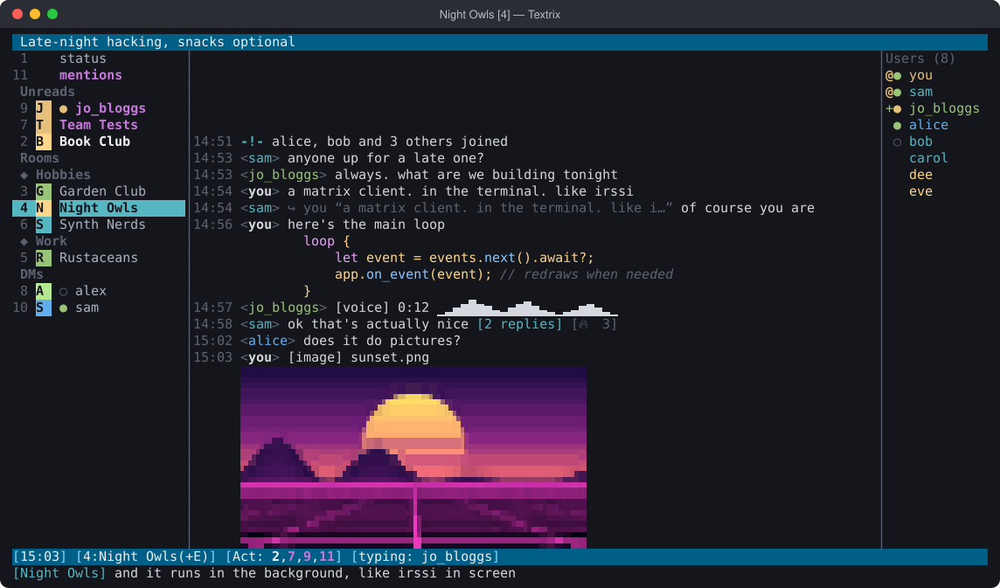

## Install

```sh
brew install seamoss/textrix/textrix      # macOS, Linux (x86_64, ARM); with completions and a man page
cargo install --git https://github.com/seamoss/Textrix   # anywhere with Rust 1.96+
```

`seamoss/textrix/textrix` is the formula `textrix` in the tap
`seamoss/textrix` (the [homebrew-textrix](https://github.com/seamoss/homebrew-textrix)
repository). Once it's installed, the short name works:

```sh
brew update && brew upgrade textrix
cargo install --git https://github.com/seamoss/Textrix --force   # the cargo way
```

`brew update` first: on its own, Homebrew looks at taps like this one
only about once a day, so a release from the last few hours wouldn't
show up yet.

A Textrix that's running then offers to switch to the new version in
place (see [Upgrading while it runs](#upgrading-while-it-runs)).

Or download a build for macOS (universal, or per chip) or Linux (x86_64,
ARM) from the [releases](https://github.com/seamoss/Textrix/releases).
Then make your dotfile (below) and run `textrix`; `textrix --check` tells
you whether everything's in place.

```text
textrix [--env FILE] [--home DIR] [--theme NAME]
textrix --daemon | --attach | --stop
textrix --check | --completions SHELL | --man | --version
```

`--check` reads the dotfile (not its secrets), config.toml and the
keychain and reports, without connecting. `--theme` picks colours for one
run. `--env` and `--home` work like `TEXTRIX_ENV` and `TEXTRIX_HOME`.

### In the background

Like irssi in screen, Textrix can keep running with no terminal:
`textrix --daemon` starts it in the background, where it stays connected,
logs and notifies (through the system's notifications while no terminal
is attached). `textrix --attach`, or plain `textrix` while it runs, shows
it in this terminal, as you left it; `/detach` leaves it running again,
and so does closing the terminal. Attaching from another terminal takes it
over. `/quit` in it, or `textrix --stop`, stops it.

The terminal and the background Textrix talk over a socket only you can
open (`~/.textrix/daemon.sock`, or one in your temp folder when that path
is too long for a socket). Only one Textrix runs per home at a time:
a second one is refused, since two would share one store and can scramble
its encryption keys.

### Upgrading while it runs

A running Textrix notices when the `textrix` it was started as changes
(`brew upgrade textrix`, a new `cargo build`) and says so in the status
bar, `[0.9.1 installed: /restart]`. `/restart` saves everything as quitting
would and becomes the new one in place: the same terminal, back in the
window you were in, every window's unsent text kept. In the background it
restarts itself, and the attached terminal follows. With
`check_updates = true`, it also asks GitHub once an hour for new releases
and shows `[0.9.1 is out]` until you have it; that's off unless you turn
it on.

## Setup

Connections come only from a private dotfile. No file, no connections.

| Build              | Dotfile                         |
|--------------------|---------------------------------|
| `cargo run` (debug)| `.textrix` in the repo (git-ignored) |
| release binary     | `~/.textrix/.env` (`.env` in `TEXTRIX_HOME` or `--home`) |
| either             | `TEXTRIX_ENV=/path/to/file`     |

```sh
cp .env.example .textrix && chmod 600 .textrix   # then fill it in
cargo run
```

Each server is a `TEXTRIX_<NAME>_*` group (`HOMESERVER`, `USER`, `PASSWORD`,
`RECOVERY_KEY`, `KEYS_PASSPHRASE`); see `.env.example`. Every server in the file connects on
startup. Secrets are read only when the API call needs them and are wiped
afterwards. They are never logged, shown, or typed into the client, and the
file is refused while other users can read it. Real environment variables
override the file, so `op run --env-file … -- textrix` works with
`op://` references.

State lives in `~/.textrix/` (`TEXTRIX_HOME` overrides it): each server's
encrypted store under `accounts/<name>/`, window order in `layout.json`,
logs in `textrix.log` (`TEXTRIX_LOG=debug` for more).

### The local store is encrypted

Each server's store (encryption keys, room state, the history cache) is
encrypted at rest with a random key that Textrix keeps, together with the
login session, in the system keychain: the macOS Keychain, or the Secret
Service via `secret-tool` on Linux. Nothing that could read your messages
sits on disk in the clear, and `/logout` removes the keychain item too.

A store from an older Textrix (`store/` and `session.json`) is converted
once at startup: Textrix exports its room keys, signs in as a new session
with the dotfile password, imports the keys, signs the old session out and
deletes the old files; the recovery key verifies the new session as usual.
If anything fails before the new session exists, it keeps using the old
store and tries again next time. Without a keychain the store stays
unencrypted (Textrix says so); `encrypt_store = false` keeps new stores
unencrypted too.

## Encryption

- Rooms are encrypted and decrypted transparently. Keys live in the local
  SQLite crypto store.
- `RECOVERY_KEY` is applied after the first sync (or run `/recover`). It
  verifies this device via cross-signing and downloads your key backup, so
  older history decrypts.
- `/verify` asks your other sessions to verify this one. `/verify accept`
  answers a request from Element, then use `/verify confirm` or
  `/verify mismatch` after comparing the emoji. Textrix verifies by emoji
  only, so Element goes straight to them (it can't show or scan QR codes).
- The status bar shows `<server>: unverified` until this device is trusted.
- `/whois <user>` shows identity and per-device trust.
- `/keys export [file]` saves every room key this device holds (to
  Downloads by default) and `/keys import <file>` loads keys, in Element's
  format, so files move both ways. The passphrase comes from
  `TEXTRIX_<NAME>_KEYS_PASSPHRASE` in the dotfile, never typed; exports are
  new files only you can read and never overwrite anything.
- `/devices` lists your sessions (most recently active first, verified or
  not, where they were last seen). `/devices rename <id> <name>` renames
  one; `/devices delete <id>` shows which session it is, and
  `/devices delete <id> confirm` signs it out. The server asks for your
  password again for that, which Textrix answers from the dotfile, like at
  login. To sign out this session, use `/logout`.

## Keys

| Key | Action |
|---|---|
| Alt+1…0, Alt+Q…P | window 1–20 |
| Ctrl+N / Ctrl+P, Alt+←/→ | next / previous window |
| Alt+A | jump to the most important active window |
| Alt+R | jump to the new-messages line in this room: the last message you'd read is selected just above it, and older history loads back to it if needed (`/jump new` too) |
| Ctrl+K, Alt+K | **quick switcher**: type part of a room's name (letters in order, like `tt` for Team Tests) or its number; ↑/↓ choose, Enter goes there. Closed windows are included. With nothing typed it lists windows with activity first, then where you were most recently, so Ctrl+K Enter flips back to the last window. Ctrl+K still cuts to the end of the line when there's text after the cursor |
| PgUp / PgDn | scroll (older history loads at the top) |
| Tab | complete commands, nicks (adds a mention), `:emoji` shortcodes, server names, file paths |
| Up / Down | input history |
| Alt+Up | **select** a message: ↑/↓ PgUp/PgDn g/G move; `r` reply, `e` edit, `d` delete, `+` react (an emoji picker: your recent ones and custom emoji first, arrows to choose, type to search; with nothing matching, Enter reacts with what you typed), `u` who sent it, `t` thread, `f` forward, `p` pin/unpin, `z` view an image full screen or play audio or video, Enter vote in a poll, `s` save attachment, `o` open link, `v` spoilers, `c` copy, `i` details (and what an edited message said before), Esc leaves |
| Shift+Up, or Ctrl+E on an empty line | **edit** your messages: ↑/↓ pick one (it loads into the input line), Enter saves, clear + Enter deletes, Esc restores your draft |
| Shift+Enter (Alt+Enter in Terminal.app/tmux) | new line in the message |
| F1 / F2 / F3 / F4 | full-screen help (type to filter) / window list / member list / home (what's waiting) |
| F6 / Shift+F6 | focus the next / previous split pane |
| Ctrl+A/E/B/F/U/K/W/Y/D | emacs-style editing; Ctrl+C clears the line |
| Alt+B / Alt+F, Ctrl+← / Ctrl+→, Home / End | back / forward a word; start / end of the line |
| Ctrl+C twice | on an empty line, quits ("press Ctrl+C again to quit"); in the background, detaches instead |
| Ctrl+X | write the message in your editor (`editor` in config.toml, else `$VISUAL`, else `$EDITOR`, else vi); save and quit, and the text is back in the input line to send. The editor works on a private temporary file, deleted when it closes, and in background mode it runs in the attached terminal |
| Ctrl+L | redraw |

**Mouse** (`mouse = true`): the wheel scrolls the pane under the pointer
(older history loads at the top) or, in selection mode, moves the
selection. Click a window in the list to go there, a pane to focus it, a
message to select it (click again to unselect), a link to open it, a name
in the member list or a nick on a message to see who they are (see
[Who's who](#whos-who)), or the input line to move the cursor.
While the mouse is on, hold Shift (Option in iTerm2 and Terminal.app) and
drag to select text, or use `c` in selection mode to copy a message.

The terminal's tab or window title follows the window you're in (the
focused pane when split), as set by `title`: `{window}`, `{number}`,
`{server}`, and `{activity}`, which adds ` [3]` while three other windows
have new messages. Inside tmux it's the pane title. The title you had is
put back when Textrix exits.

The window list (F2) puts rooms and DMs with messages you haven't read
under **Unreads** at the top, mentions first; once you've read them they
go back to **Rooms** (grouped under their spaces, if you're in any) or
**DMs**, each by name. A window's number stays the same wherever it's
listed, so Alt+1..0 and `/window N` always find it.

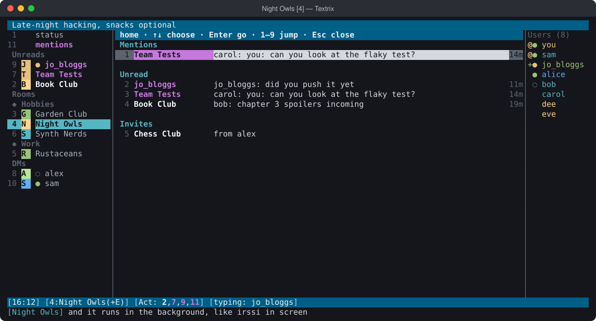

Home (F4, or `/home`) shows what's waiting in one place, over the
messages: your mentions from the last day (the latest five), every room
with unread messages and what was said there last (mentions first, then
the most recent), and your invitations. ↑/↓ and Enter, a click, or the
row's number (1–9) goes there: to the message, the room, or, for an
invitation, joining it; `d` twice declines one. Esc or F4 goes back.

While you type a command, its usage appears in dim text after the cursor.

What you've typed stays with its window: switch away and it's waiting when
you come back (`…` in the window list marks windows with unsent text). A
paste of more than 5 lines asks `y/n` before it's sent, so a stray
clipboard can't end up in a room; `n` leaves it in the input line to edit
(`paste_confirm_lines`, 0 turns it off). Lines you type with Shift+Enter
never ask.

On macOS, set your terminal's Option key to act as Meta/Esc+ for the Alt
bindings.

## Commands

`/help` lists everything; `/help <command>` shows usage.

| Area | Commands |
|---|---|
| Rooms | `/create [-public] [-space] <name>`, `/join`, `/name`, `/topic`, `/info`, `/rooms`, `/invites`, `/decline`, `/part`, `/forget`, `/invite`, `/kick`, `/ban`, `/unban`, `/names` |
| Room settings | `/joinrule <invite\|public\|knock\|restricted <space>>`, `/guests <on\|off>`, `/history <joined\|invited\|shared\|world>`, `/publish <on\|off>` (room directory), `/upgrade [<version> confirm]` (shows versions first; confirming moves you to the new room); `/info` shows them all. `/close` shuts a room you own down for everyone: it says what it will do, and `/close confirm` makes it invite-only, takes it off the directory, removes its addresses, withdraws invites, removes every member less powerful than you, then leaves and forgets it. Matrix has no "delete room" for clients (other servers keep their copy while their members are in it), but when you're an admin on your Synapse homeserver, `/close` also has it delete the room and block it there |
| Directory | `/list [search]` (public rooms) |
| Spaces | `/spaces`, `/space <name>` (browse, including rooms you haven't joined), `/space <name> add\|remove` (the current room), `/space <name> leave`, `/create -space <name>`; the window list groups rooms under their spaces without renumbering them |
| Links | `/urls` (numbered, newest first), `/open [N]`; `o` in selection mode, or click one. Links are real hyperlinks in terminals that have them (Ghostty, iTerm2, kitty, WezTerm…): hovering shows where they go and Cmd/Ctrl+click opens them, a link wrapped over lines included; `hyperlinks = false` turns that off. The page title of a message's first link shows under it (`↳ Title — Site`), and under that the page's picture, small, when it has one (`link_images = false` leaves pictures out). Both come from your homeserver's URL preview, picture included, so the site never sees you. That's on in unencrypted rooms, which the server reads anyway; `link_titles = "all"` adds encrypted rooms (the server then sees those links), `"off"` stops it. Synapse needs `url_preview_enabled` for this; Textrix tells you once if it's off |
| Forwarding | `f` in selection mode opens a "Forward to" list of that server's other rooms (closed ones too), filtered as you type like the switcher; Enter sends a copy and leaves you where you are. `/forward [room]` does the same for the latest message here. The copy keeps formatting and attachments but not reply or thread links or mentions, so nobody is pinged again; an edited message goes as its edited text. Forwarding out of an encrypted room into one that isn't says so |
| Pins | `p` in selection mode pins a message for everyone in the room, or unpins it (needs the power level to change pins). Pinned messages show `[pinned]`, and the topic bar counts them. `/pins` lists them, newest pin first; `/jump N` goes to one |
| Threads | `/threads` (the room's threads), `/thread [N]`, or `t` on a message in selection mode (starts a thread if it has none) opens a thread window: root first, then replies; typing there replies in the thread. Thread roots show `[N replies]`; replies also appear in the room with their context |
| Search | `/search <text>` across every room, newest first, `/jump N` to land on a result in selection mode. Narrow it with `from:sam` (a name, your nickname for them, or their Matrix ID), `in:"Book Club"` (part of a room's name), `after:2026-01` and `before:2026-06-30` (a year, month or day, or `today`, `yesterday`; `before` doesn't include the day itself; `since:` and `until:` work too); `/search from:sam in:"Book Club"` alone lists all they said there. It searches a local index of decrypted messages (servers can't search encrypted rooms): new messages go in as they arrive, and older history is read back gently in the background, up to 20,000 messages a room. The index is encrypted with the same keychain key as the store, follows edits and deletions, and is removed by `/logout` or `search_index = false`. Without an encrypted store there's no index, and `/search` covers loaded history; `/search -deep …` also reads the last 500 messages of each room that has a window open |
| Messages | plain text (Markdown), `/me`, `/notice`, `/msg`, `/query`, `/reply [nick] <text>`, `/react [nick] <emoji>`, `/edit [text]`, `/redact`, `/lastlog [-n N] [-nick nick] <text>`, `/say <text>` (or `//text`) sends text that starts with `/` as it is, `/poll <question> \| <answer> \| <answer>…` and `/poll end` (see [Polls](#polls)), `/later <when> <text>` (see [Sending later](#sending-later)), `\|\|spoiler\|\|` hides that part until it's revealed (not inside code), `/exec <command>` runs a shell command and shows what it printed here, `/exec -o <command>` sends that to the room (30 seconds at most, 500 lines; scripts can't use it) |
| Files | Images you send carry a thumbnail and a blurhash (the blurred placeholder) the way Element sends them, so they show quickly everywhere; videos carry a poster frame (from Quick Look on macOS, ffmpeg elsewhere), their length and size. Drop files on the terminal (any kind, one or several) and Textrix asks "upload notes.pdf (1.2 MB) to Night Owls? Enter/y uploads, n keeps it as text"; `n` leaves the paths in the input line as text. `/upload <path>` (Tab completes paths; dropped/escaped paths work), `/download [nick]` (saves to Downloads, never overwrites), `/play [nick\|stop]` (voice, audio and video; see below), `/media` (the room's pictures, videos and files as tiles; see [The media gallery](#the-media-gallery)) |
| Windows | `/window <n\|list\|close\|move n\|goto name>`, `/wc`, `/wl`, `/clear`, `/sidebar`, `/nicklist`, `/mentions`, `/home` (F4), `/theme [name \| list \| here <name\|off> \| space <space> <name\|off> \| save <name> \| import <file>]` (on its own, or `/themes`: pick one with a preview; see [Themes](#themes)) |
| Reading | `/markread` marks this room read, `/markread all` every room: clears activity and unread counts, moves the new-messages divider to the end, and updates your read marker (and receipt, per `read_receipts`) so other clients agree |
| Aliases | `/alias tt /window goto Team Tests` makes `/tt`. irssi-style: `$0`, `$1`… are its arguments, `$1-` the first onwards, `$*` all of them (with none of these, arguments go on the end), and `;` runs several commands (`/alias rr /markread all; /window 1`). Aliases are saved in `config.toml` under `[aliases]`, the rest of the file left as it is; `/alias` lists them, `/unalias <name>` removes one. They can't replace built-in commands |
| Your names | `/window name Ops` shows this window as "Ops" everywhere in Textrix (window list, status bar, pane titles, switcher, the terminal title) without renaming the room for anyone else; the room's own name still finds it in the switcher and `/window goto`. `/window name` on its own puts it back. Names are kept in `layout.json` |
| Nicknames | `/nickname sam Sammy` shows that person as "Sammy" everywhere in Textrix: on their messages and replies to them, read markers, typing notices, the member list, notifications, and their DM window. Only you see it; Tab finds them by either name but inserts their own, so a nickname never ends up in a message. `/nickname sam` takes it off, `/nickname` lists them. Kept in `layout.json` |
| Split panes | `/split <window>` (below) or `/vsplit <window>` (beside) shows another window at the same time, up to 4; each pane has its own title bar, and `▶` marks the one you're typing in. Going to a window that's already in a pane focuses it; any other window replaces the focused pane's. `/unsplit` closes the focused pane (the window stays open), `/unsplit all` keeps only it. Drag the line between two panes (or the upper one's title bar) to resize them, or `/resize +5`, `/resize -5` (rows, or columns side by side), `/resize =` to even them up. The split you quit with is back next time, sizes and all. `/layout save <name>` keeps the panes (and whether the window and member lists show) to bring back with `/layout load <name>` or `/layout <name>`; `/layout` lists them, `/layout delete <name>` removes one |
| Account | `/servers`, `/connect`, `/disconnect`, `/logout`, `/nick`, `/away [-all] [message]`, `/ignore`, `/unignore`, `/whois`, `/verify`, `/recover`, `/avatar <image>\|-remove`, `/roomavatar <image>\|-remove`, `/version [check]`, `/changelog [N]` (what changed in the latest N releases, 10 unless you say, from GitHub's release notes), `/restart` (into a newly installed version, back where you were), `/devices [rename <id> <name> \| delete <id> [confirm]]`, `/keys export [file] \| import <file>`, `/quit` |
| Session | `/set [name [value]]`, `/save`, `/reload` (see [Optional preferences](#optional-preferences)), `/log [on\|off]`, `/detach`, `/help [command]` |
| Scripts | `/script` (or `/script list`) lists them, `/script load\|unload <name>`, `/script reload [name]` (no name: every file), `/script exec <code>`; see [Scripts](#scripts) |
| Notifications | `/notify [all\|mentions\|mute\|default]`, `/hilight [word]`, `/dehilight <word>`, `/bell [on\|off\|away\|sound\|visual\|both\|test]` (see below) |

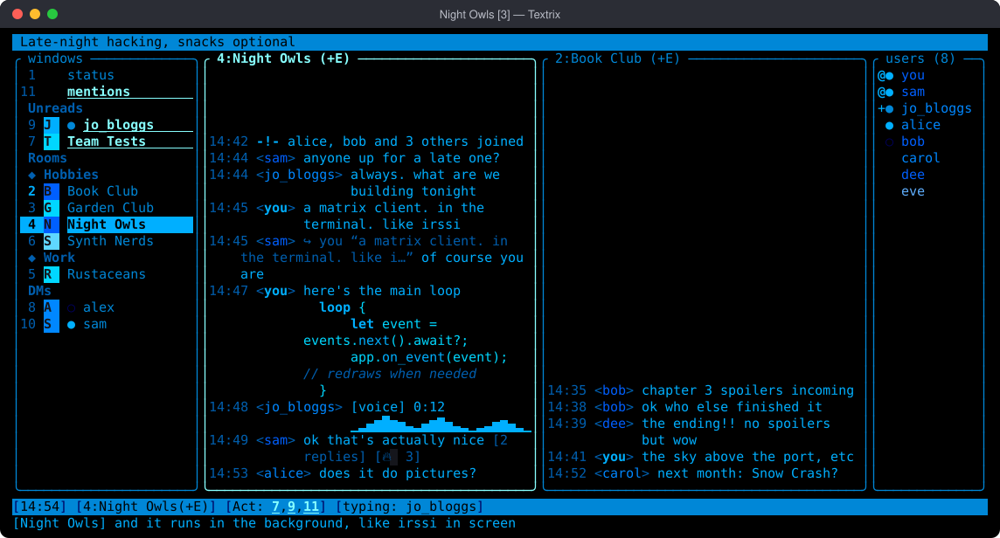

Editing follows Matrix's rules: only your own text messages, and only where
your power level lets you post. Deleting someone else's message needs
moderator rights; Textrix checks before asking you to confirm.

When several servers are connected, prefix a command with `-<server>` while in
the status window (e.g. `/join -work #ops:work.example`).

### The nick column

Nicks sit in a column: `<sam>`, then spaces up to a bar, so every message
starts in the same place and its wrapped lines stay on their side of the
bar. Nicks longer than 12 characters are cut short (`nick_column` sets how
many; 0 puts nicks inline, `<sam> hi`), and panes too narrow for the
column keep them inline. Joins show `-->` there, leaves `<--`, and
Textrix's own lines `-!-`.

System messages, the `-!-` lines (Textrix's own, joins and leaves, topic
and room changes, day changes), are in italic in every theme, so they
don't read as the conversation; `system_italic = false` keeps them
upright. Textrix's own lines (replies to your commands, errors,
netsplits) are also set apart in a room: a blank row before and after
each run of them, in the theme's quiet colour.

### Joins and leaves

Runs of two or more joins, leaves and name changes (on the same day) show
as one line, like `alice, bob and 5 others joined · dave left · eve →
erin`. Kicks, bans, invitations and requests to join always get their own
line. `fold_joins = false` shows every change; `show_joins = false` hides
them all.

### Formatting

Formatted messages render as styled text: bold, italic, strikethrough,
inline code and code blocks, quotes (`▎`), bullet and numbered lists,
headings, coloured text, links (with the address when the text differs),
mention pills, and spoilers (hidden until you press `v` in selection mode).
Code blocks are syntax-coloured when they say their language (```` ```rust ````,
or a `#!` line), in colours that follow the theme: a monochrome theme
uses shades of its one colour. What you send is Markdown (`markdown = true`) and shows formatted right away.
Emoji shortcodes (`:fire:`, `:+1:`, GitHub/Slack names) turn into emoji when
you send, react or edit, except inside backticks; `:thu` + Tab completes
them, showing which shortcode you're on as you cycle.

Custom emoji from image packs (the room's, your own, and packs you've
made global, in Element or Cinny) show by their `:shortcode:` in the
theme's accent colour, in messages and reactions. Tab completes their
shortcodes too, first; they stay `:shortcodes:` in the input line and go
out as the pictures other clients show, in messages, replies, edits and
reactions.

### Chat logs

Off by default: logs hold decrypted messages in plaintext. `log = true` (or
`/log on` for just this session) writes irssi-style daily files to
`~/.textrix/logs/<server>/<room>/<YYYY-MM-DD>.log`, readable only by you,
covering what arrives while you're connected: messages, emotes, notices,
joins and parts, edits, deletions and thread replies.

### Sync

New sessions use Simplified Sliding Sync (MSC4186) when the server offers it,
which loads big accounts faster; otherwise Textrix long-polls the classic
`/sync`. A session keeps the method it started with: Synapse can't carry a
classic session's encryption stream position over to sliding sync, so an
existing session stays on classic sync (to switch, `/logout` and reconnect).
Sliding sync has no presence, so presence dots there only update via
`/whois`. Force a method with `sync = "classic"` or `"sliding"`.

When the connection drops, it's a netsplit: `Netsplit example.org ⇄ you,
quits: …`, then `Netsplit over after 2m 13s, joins: …` once it's back.

### History at startup

Messages that arrive while Textrix runs are kept in the account's local
store (the SDK's event cache), so at the next launch each window shows its
recent messages straight away, before the server has answered. If more
arrived while Textrix was closed than the first sync delivers, that room's
cached lines are dropped and its history loads from the server as usual,
so you never see old and new messages joined across a gap. Older history
still loads from the server when you scroll up.

The cache lives in the encrypted store; `/logout` deletes it, and
`history_cache = false` turns it off and clears it.

### Images

Stickers show like images, under their name.

The window list shows each room's avatar (a DM falls back to the other
person's) as a tiny image in terminals with graphics, and a coloured initial
tile elsewhere.

Images show inline under their message. Textrix asks the terminal what it
supports at startup, and says in the status window: kitty graphics (kitty,
Ghostty, WezTerm), iTerm2 inline images, or sixel. Elsewhere (Terminal.app,
VS Code, Claude's desktop app) pictures are drawn in text, each character
split into blocks in two colours: sextants (2×3) where the terminal draws
them itself, quadrants (2×2, in every font) otherwise; `image_text` picks
`"sextants"`, `"quadrants"` or `"halfblocks"` instead. Images are always
scaled down smoothly. Encrypted images use the sender's thumbnail when there
is one; otherwise the image itself is fetched (up to 20 MB) and decoded with
size and memory limits. Inside tmux, graphics need
`set -g allow-passthrough on`. `s` in selection mode or `/download` saves the
original.

`z` on an image in selection mode, or a click on it, opens it full screen:
the original is fetched (up to 50 MB) and decoded in memory only, never
written to disk. `+`/`-` or the mouse wheel zoom (up to 16×), the arrow
keys (or `hjkl`) move around, `0` fits it again, and Esc closes. With
kitty, iTerm2 or sixel graphics it's sharp; with half-blocks, zooming in is
how you see the detail.

### Polls

Polls (Element's, or the stable kind) show their answers under the
question, with the results as bars and `✓` by yours, and how many voted:
while the poll's open when its starter chose to show results, otherwise
once it's ended. Select one (Alt+Up) and press Enter to vote: ↑/↓ and
Enter, a number for one answer, or Space to tick several where the poll
allows. `/poll Pizza tonight? | yes | no | maybe` starts one (results
shown, one answer each, the way Element makes them), and `/poll end` ends
your latest open one here, saying how it came out.

### Sending later

`/later 10m <text>` sends it in ten minutes, `/later 1h30m <text>` in an
hour and a half (`90s` and `2d` work too); `/later 18:30 <text>` at the next 18:30, `/later tomorrow
9:00 <text>` tomorrow morning. `/later` lists what's waiting, `/later
cancel 2` (or `all`) takes it back. Textrix sends them, so it has to be
running then (in the background is fine); one that falls due while
you're offline goes when you're back. They're kept on disk sealed with
your store's keychain secret, or only until Textrix closes without a
keychain. (Servers that schedule messages themselves can't do it for
encrypted rooms, where the message has to be encrypted when it's sent.)

### Voice messages and video

Voice messages show their length and waveform, `[voice] 0:12 ▁▃▅▇▅▃▁`, and
other audio its length. `z` (or Space) on one in selection mode plays it,
and again stops it; `/play [nick]` plays the latest here, `/play stop`
stops. The status bar shows `▶ playing` meanwhile. Textrix fetches and
decrypts it, decodes Element's Ogg Opus itself, and hands it to the
system's player (`afplay` on macOS; `pw-play`, `paplay`, `mpv`, `ffplay`
or `aplay` on Linux, or whatever `audio_player` says) from a private file
that's deleted as soon as it stops.

Videos show their length and size, `[video] clip.mp4 (0:42, 1920×1080)`,
and their poster frame inline when the sender included one. `z` (or
Space, or `/play`) fetches and decrypts one (up to 200 MB) and opens it
in mpv if you have it, otherwise in the app your system uses for that
kind of file (QuickTime Player on macOS, which can't play `.webm`; set
`video_player`, e.g. to `"mpv"`, for one that can). The decrypted copy
stays in a private folder until Textrix closes.

### The media gallery

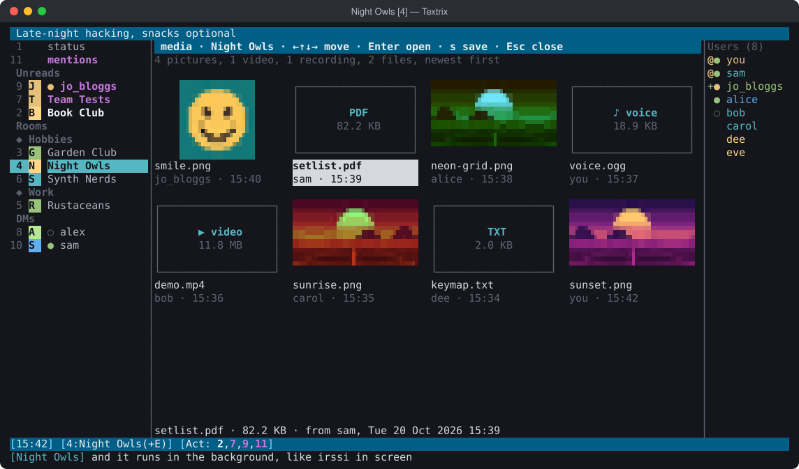

`/media` shows the room's pictures, videos, voice messages and files as
tiles, newest first, over its messages: pictures as small pictures, the
rest as boxes saying what they are. Arrow keys (or the mouse) move
through them, Enter opens one (a picture in the viewer, audio and video
played, a file saved) and `s` saves any of them to Downloads; Esc goes
back. As you get near the end of what's loaded it fetches more of the
room's history, back to the beginning if you keep going; the line at the
top says how far it's got.

### Who's who

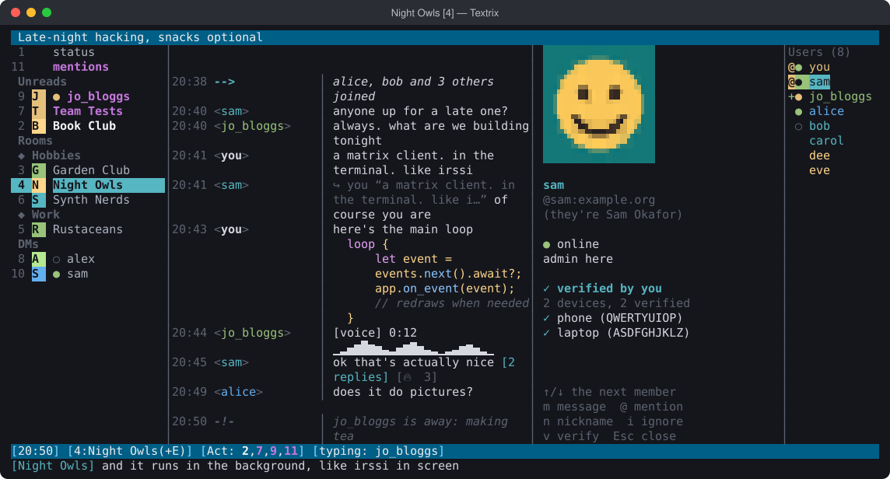

Click a name in the member list, or a nick on a message (`u` in selection
mode; in the mentions window, where a click goes to the message, `u` is
the way), and their profile opens beside the member list: their picture,
their name and yours for them, Matrix ID, presence, role in the room,
whether you've verified them and their devices. ↑/↓ goes through the
member list. `m` opens a DM with them and `@` mentions them; `n`
(nickname), `i` (ignore) and `v` (verify) put the command in the input
line for you to send. Esc closes it.

### Reading state

- A red **new messages** divider marks where you stopped reading. It starts at
  your shared read marker (the same one Element uses) and moves when you leave
  a window or send a message.
- `✓ nick` after a line shows how far other members have read.
- Presence: coloured dots in the member list and on DM windows in the
  window list (green online, yellow away, grey offline); a DM's topic bar
  says how the other person is doing ("away: lunch", "last seen 3h ago");
  `/whois` includes it. `✎` in the window list means someone is typing there;
  typing notices clear when that person's message arrives, and expire after
  45 seconds without an update.
- Like irssi's "is away": when you write to someone who's away (in your DM
  with them, by mentioning them, or replying to them), a line says so
  ("sam is away: lunch"), when it's news: they're away with a status, or they've
  been gone half an hour or more ("sam is offline, last seen 3h ago").
  Presence is only a guess (a missed heartbeat reads as offline, and some
  people and servers don't share it), so a bare "offline", a few idle
  minutes, or someone who's said something in the last quarter of an
  hour, never get a note; and the same note comes at most once an hour,
  unless their status changes. `away_notes = false` turns them off. It
  uses the presence your server shares, so not on sliding sync.
- Messages that mention you or a highlight word are collected, from every
  room and in time order, in a **mentions** window (listed under status;
  `/mentions` opens it). Click one, or select it and press Enter, to go to
  the message in its room. Mentions found when history loads join it too.
- Like irssi's awaylog: while you're `/away`, direct messages collect in
  the mentions window too. Coming back says what came in ("while you were
  away (1h 5m): 3 mentions (Team Tests) and 2 DMs (sam), in the mentions
  window") and opens it.
- Highlights and DMs from other windows (or any window while the terminal is
  in the background) ring the bell and pop a desktop notification in
  iTerm2, Ghostty, WezTerm and kitty. Inside tmux, notifications need
  `set -g allow-passthrough on`, and `c` (copy) in selection mode needs
  `set -g set-clipboard on`.
- Textrix moves your read marker as you read, and sends read receipts as set
  by `read_receipts`.

### The status bar

`statusbar` lists what the status bar shows, in order, and `statusbar2`
adds a second bar above it. Items with nothing to say stay out of the
way, and prompts ("press Ctrl+C again to quit", "upload …? y/n", the keys
in selection mode) always come at the end of the first bar.

```toml
statusbar = ["time", "nick", "window", "activity", "typing", "scripts", "upgrade", "playing", "servers", "more"]
statusbar2 = ["date", "users", "theme"]
```

The items: `time`, `date`, `nick` (your name on the window's server),
`window` (its number and name, `(+E)` when encrypted), `users` (how many
are in the room), `activity` (`Act: 2,7`), `typing`, `scripts` (scripts'
items), `upgrade` (a newer Textrix), `playing` (audio), `servers` (away,
unverified, connection trouble), `theme` (the theme on screen), `more`
(scrolled up). A name it doesn't know stops Textrix with the list.

### Notifications

By default, mentions of you, highlight words and direct messages alert you
(bell, desktop notification, and mentions go to the mentions window); other messages
just light up the window list. `/notify` changes that per room, stored as
Matrix push rules so Element and your phone follow the same setting:

| `/notify …` | Effect |
|---|---|
| `all` | every message alerts you |
| `mentions` | only mentions and highlight words alert; other messages show quietly |
| `mute` | nothing alerts, even mentions; the room is dimmed in the window list |
| `default` | back to the default |

The bell rings for mentions and DMs (and every message in rooms set to
`/notify all`), new invitations, verification requests, messages that
failed to send, and finished uploads and downloads; `bell_for` picks which.
A burst rings once (rings are at least two seconds apart). `/bell off`,
`/bell away` (only while the terminal is in the background, in terminals
that report focus) and `/bell visual` (flash the status bar instead of the
sound) change it for the session; `/bell test` tries it. Inside tmux the
bell marks the window in tmux's status line.

`/hilight <word>` highlights a word in every room, like a mention (also
synced, so your other clients notify on it too); `/hilight` lists them and
`/dehilight <word>` removes one. `/info` shows a room's setting.

#### Notification hooks

`notify_command` in config.toml runs a command of yours for each of those
alerts (mentions, DMs, rooms set to `/notify all`, when you aren't looking
at the room), whether desktop notifications are on or not, and also while
Textrix runs in the background with no terminal. Use it to push to your
phone, light up a lamp, or log them. The details come in environment
variables, never pasted into the command, so a message can't slip
anything into your shell:

| Variable | What |
|---|---|
| `TEXTRIX_KIND` | `mention`, `dm`, or `message` (a room set to `/notify all`) |
| `TEXTRIX_TITLE` | the desktop notification's title: `sam in Night Owls`, or `sam` for a DM |
| `TEXTRIX_FROM`, `TEXTRIX_FROM_ID` | who: their name (your nickname for them, if you gave one) and Matrix ID |
| `TEXTRIX_ROOM`, `TEXTRIX_ROOM_ID` | where |
| `TEXTRIX_SERVER` | which of your servers |
| `TEXTRIX_TEXT` | the message (empty with `notify_preview = false`) |
| `TEXTRIX_AWAY` | `1` while you're `/away`, else `0` |

```toml
# Push to your phone with ntfy, but only while you're away:
notify_command = 'if [ "$TEXTRIX_AWAY" = 1 ]; then curl -s -d "$TEXTRIX_TEXT" -H "Title: $TEXTRIX_TITLE" ntfy.sh/your-topic; fi'
```

It runs with `sh -c`, four at most at once, each stopped after 30
seconds. If it fails, Textrix says so once in the status window (with
the first line it printed to stderr), and again only after it has worked
in between. Scripts can't change it, or `editor` and `video_player`,
which also run programs.

### Themes

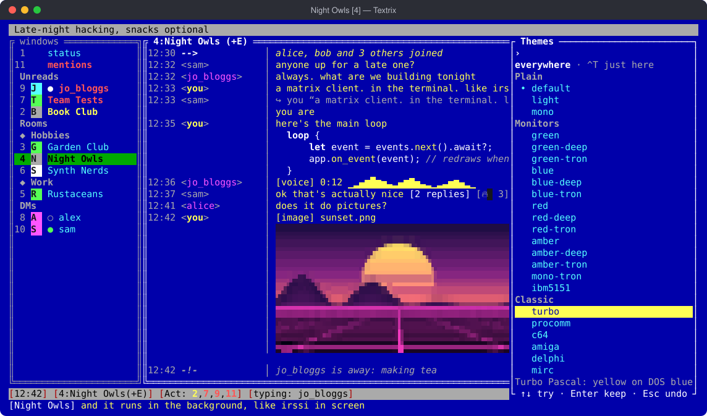

`/theme` (or `/themes`) opens the list. Moving through it with ↑/↓ (or
the mouse) shows each theme on the whole screen, typing narrows the list,
Enter keeps the one you're on for the session and Esc puts back the one
you had. `/save` keeps it for good, like `theme = "<name>"` in
config.toml. `/theme <name>` goes straight to one, `/theme list` lists
them in the status window, and `--theme <name>` picks one for a run. A
few have other names too: `dark` (default), `phosphor` (green),
`virtualboy` (red), `solarized` (solarized-dark), `mocha` (catppuccin),
`ibm` (ibm5151), `outrun` (synthwave), `cemetary` (cemetery),
`colourblind` (colorblind), and a few more.

`theme = "auto"` (first in the list) follows your terminal: when Textrix
starts it asks the terminal for its background colour (or reads
`COLORFGBG`, which some terminals set) and takes `theme_dark` on a dark
one, `theme_light` on a light one: `default` and `light` unless you say
otherwise, e.g. `theme_dark = "nord"` and `theme_light =
"solarized-light"`. In the background (`--daemon`) it asks each terminal
that attaches. A terminal that doesn't answer counts as dark.

A room can keep a theme of its own, so work and play look different at
a glance: `/theme here amber-deep` (or Ctrl+T in the list, for "just
here"), `/theme here off` to give it yours again. `/theme space Work
turbo` does it for every room in a space; a room's own still wins. The
screen takes the theme of the room you're in. These are kept in
`layout.json` straight away; your own theme is still kept by `/save`.

| Shelf | Themes |
|---|---|
| Plain | `auto` (dark or light to match the terminal, see above), `default` (for dark backgrounds), `light`, `mono` (no colour at all: bold, underline and reverse video) |
| Monitors | `green`, `blue`, `red` (Virtual Boy), `amber` and `purple`: one colour on black, each also `-deep` (on deep blue with every panel framed in double lines, like an 80s airport terminal) and `-tron` (on pure black with thin neon outlines). `mono-tron` is Tron in greys, and `ibm5151` the IBM monochrome display's green, its panels framed in ASCII |
| Classic | `turbo` (Turbo Pascal's DOS blue), `procomm` (a DOS terminal program dialling a BBS), `c64`, `amiga` (Workbench 1.3), `delphi` (Delphi 7), `mirc`, `solarized-dark`, `solarized-light`, `gameboy` (the original's four greens), `teletext` (Ceefax), `bsod` (white on Windows blue), `hotdog-stand` (Windows 3.1's red and yellow) |
| Nouveau | `monokai`, `dracula`, `nord`, `gruvbox`, `catppuccin` (Mocha), `synthwave` (the 80s: neon pink and cyan on a midnight-purple sky, the sun setting in yellow and orange), `miami-heat` (art deco at dusk), `cemetery` (granite, moss and candlelight), `summer-evening` (light: a peach sky, coral and lavender), `abyss` (deep-sea glow), `noir` (black and white, red for what matters), `espresso` |
| Wild | `vaporwave` (pastel pink, teal and Windows 95 grey), `radioactive` (toxic green and hazard stripes), `disco` (a mirror ball) |
| Accessible | `colorblind` and `colorblind-light` (for red-green colour blindness: blue and orange, never red against green; online is blue, away orange), `tritan` (for blue-yellow colour blindness: red against cyan), `high-contrast` (black and white with yellow and cyan) |

<table>
<tr>
<td>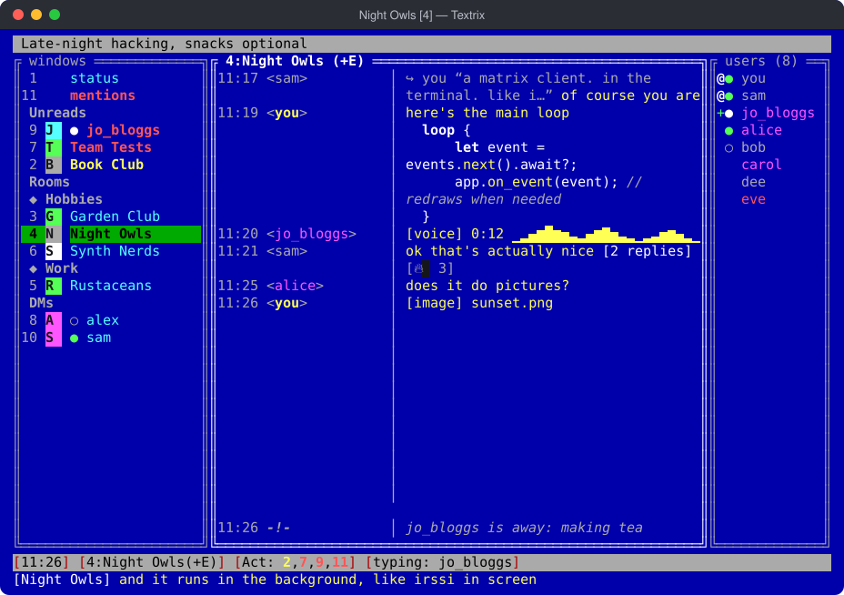<br><code>turbo</code></td>
<td>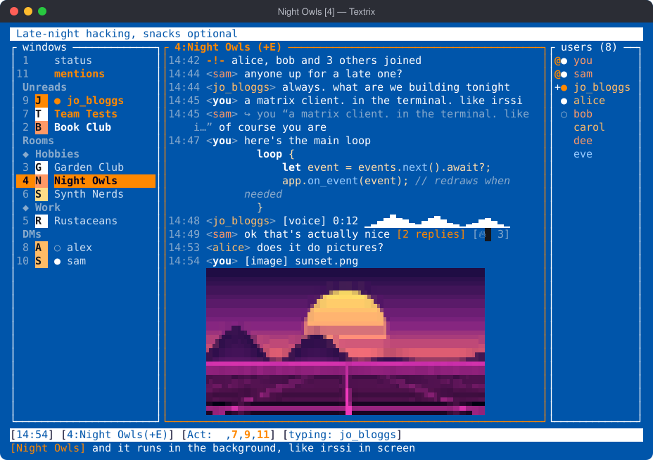<br><code>amiga</code></td>
<td>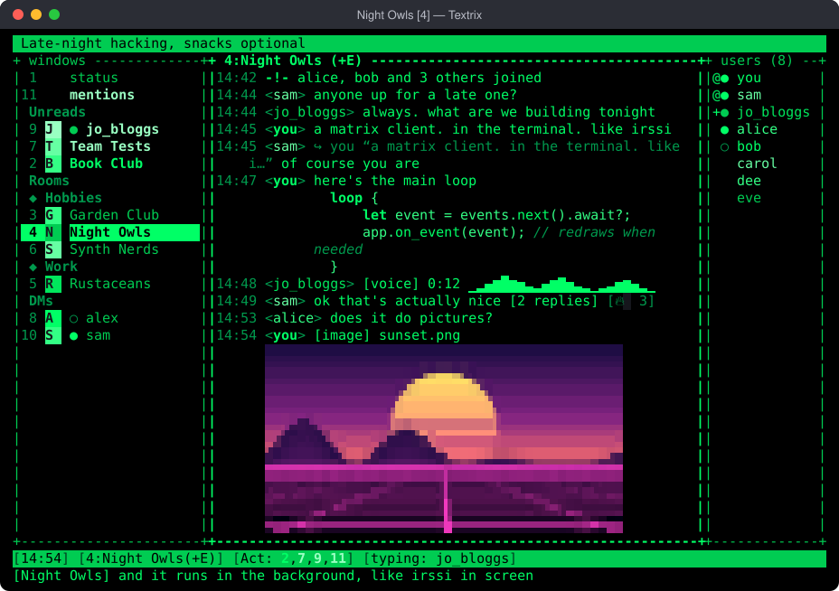<br><code>ibm5151</code></td>
</tr>
<tr>
<td>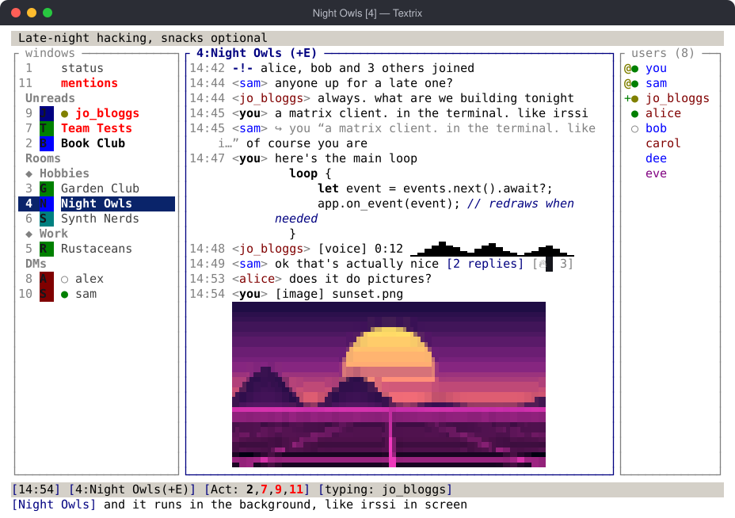<br><code>delphi</code></td>
<td>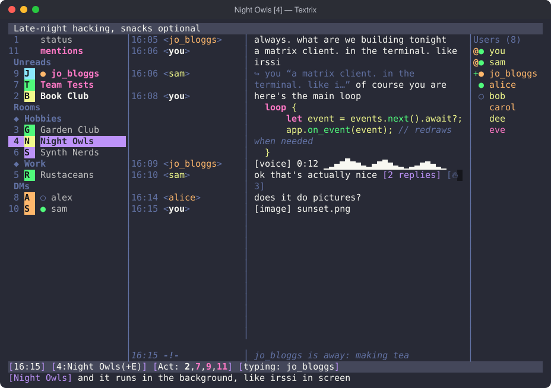<br><code>dracula</code></td>
<td>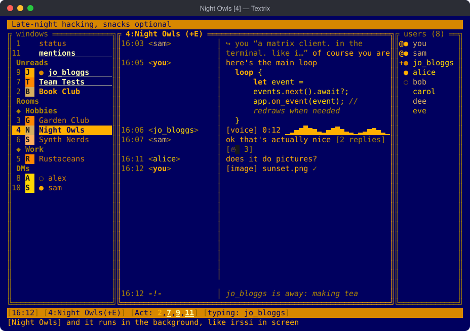<br><code>amber-deep</code></td>
</tr>
</table>

The website has [every theme to try on](https://seamoss.github.io/Textrix/themes.html).
The plain themes use your terminal's own background; the rest bring their
own, and the Tron ones are #000000 whatever your terminal's colour scheme
calls black. In terminals without 24-bit colour (no
`COLORTERM=truecolor`), Textrix uses the nearest of the 256 colours.

A `[colors]` table in config.toml changes single parts of whichever theme
you use, by colour name (`lightcyan`), `#rrggbb`, or a 256-colour number:

```toml
theme = "light"

[colors]
bar_bg = "#203050"
link = "lightcyan"
nicks = "red, 214, #00aa88, blue"   # the colours nicks are picked from
```

The keys: `background`, `foreground` (under everything), `bar_fg`,
`bar_bg`, `bar_accent`, `bar_alert` (the topic and status bars),
`pane_fg`, `pane_bg` (unfocused split panes), `dim`, `accent`, `frame`,
`own_nick`, `highlight`, `highlight_text`, `error`, `divider`, `link`,
`mention`, `code`, `code_comment`, `code_keyword`, `code_string`,
`code_number`, `code_function`, `code_type` (syntax colours in code
blocks), `badge` (reply counts), `pinned`, `receipts`, `matched`,
`current_fg`, `current_bg`, `shown`, `inactive`, `activity_event`,
`activity` (the window list), `op`, `voice`, `online`, `away`, `offline`
(the member list), `border`, `border_focus` (outlines), and `nicks`. A
typo stops Textrix with the list of keys rather than being ignored.

#### Your own themes

A theme file, `~/.textrix/themes/<name>.toml`, starts from a built-in
theme and changes what you like. `/theme <name>` uses it like any other:

```toml
# ~/.textrix/themes/midnight.toml
name = "midnight"             # what /theme import calls it
description = "blue-tron, later"
base = "blue-tron"            # any built-in theme
outlines = "rounded"          # none, plain, rounded, double, thick or ascii
message_colors = false        # show the colours senders put in messages

[colors]                      # the keys above
background = "#000010"
foreground = "#c0d0ff"
bar_bg = "#102040"
nicks = "#7aa2f7, #bb9af7, #9ece6a"
```

`/theme save <name>` writes the look you have now (the theme with your
`[colors]` changes) to a file like that, ready to send to someone;
`/theme import <file>` checks one you were sent and adds it. A theme file
holds colours and nothing else, so there's nothing in it to run. A mistake
in one says what and where, and `/reload` reads it again after you edit
it.

### Scripts

Like irssi's Perl scripts, but in [Rhai](https://rhai.rs): each `.rhai`
file in `~/.textrix/scripts/` loads at startup and can add commands and
react to messages.

```rhai
command("shout", "Say it in capitals", |args, ctx| say(args.to_upper() + "!"));

on_message(|msg| {
    if matches(msg.body, "(?i)\\bpizza\\b") { bell(); }
});
```

Scripts can keep things across restarts, have settings that `/set` and
`/save` handle like the rest, put items in the status bar, run on timers,
and hear joins, leaves, reactions and highlights. They're
sandboxed (no files, network or programs, and a runaway loop is stopped)
and rate-limited to 5 messages per 10 seconds.
[SCRIPTING.md](SCRIPTING.md) has the whole API, and
[examples/scripts](examples/scripts) has dice, `/seen`, watch words, a
DM counter and `/remind` to start from.

## Optional preferences

`~/.textrix/config.toml` holds your preferences (all keys optional).
`/set` lists them and `/set <name> <value>` changes one for the session
(`/set theme blue-deep`; `sync`, `encrypt_store`, `search_index`,
`history_cache`, `check_updates`, `scripts` and turning `image_previews`
on take effect at the next start); `/save` writes the session's settings back into
the file, including what `/theme`, `/bell`, `/log`, F2 and F3 changed,
leaving your comments alone. After editing the file by hand, `/reload`
applies it (and picks up servers added to or removed from the dotfile):

```toml
timestamp_format = "%H:%M"
nick_column = 12           # nicks in a column this wide (0: inline)
editor = ""                # Ctrl+X opens this ("" uses $VISUAL, then $EDITOR, then vi)
statusbar = ["time", "nick", "window", "activity", "typing", "scripts", "upgrade", "playing", "servers", "more"]
statusbar2 = []            # a second bar above, e.g. ["date", "users", "theme"]
system_italic = true       # -!- lines in italic
away_notes = true          # "sam is away: lunch" when you write to them, if it's news
show_joins = true
link_titles = "unencrypted" # page titles under links: "all", "off"
link_images = true         # and the page's picture under its title
hyperlinks = true          # links as real hyperlinks (OSC 8)
fold_joins = true          # runs of joins/leaves/renames become one line
markdown = true
send_typing = true
read_receipts = "public"   # "private" (only your clients see it) or "off"
bell = true                # false, or "away": only while the terminal is in the background
bell_style = "sound"       # "visual" flashes the status bar, "both" does both
bell_for = ["mentions", "invites", "verification", "failed_sends", "transfers"]
notifications = "auto"     # or "osc9", "osc777", "osc99" (kitty), "off"
notify_preview = true      # include message text in notifications
notify_command = ""        # run this for each notification (see Notification hooks)
log = false                # chat logs (plaintext!); /log on|off per session
log_dir = "~/.textrix/logs"
sync = "auto"              # or "sliding", "classic"
image_previews = true      # inline images
image_rows = 10            # their maximum height
image_text = "auto"        # without graphics: "sextants", "quadrants" or "halfblocks"
audio_player = ""          # e.g. "mpv --no-video"; "" uses the system's player
video_player = ""          # e.g. "mpv" or "open -a IINA"; "" uses mpv, else the system's app
sidebar = true             # window list (F2)
sidebar_avatars = true     # room avatars there (coloured initials without graphics)
nicklist = true            # member list (F3)
mouse = true               # wheel and clicks (hold Shift/Option to select text)
paste_confirm_lines = 5    # ask before sending longer pastes (0: never)
theme = "default"          # or one of the others /theme list lists, or your own; [colors] overrides
theme_dark = "default"     # what theme = "auto" picks on a dark background
theme_light = "light"      # and on a light one
title = "{window}{activity} — Textrix"   # the terminal's title; "" leaves it alone
history_cache = true       # show recent messages instantly at startup
encrypt_store = true       # encrypt the local store, key in the system keychain
check_updates = false      # hourly, ask GitHub whether a newer release is out
search_index = true        # encrypted local index of messages for /search
scripts = true             # load ~/.textrix/scripts/*.rhai at startup
scrollback = 5000
history_page = 50
completion_char = ":"
```

## Secrets

If you grew up on mIRC and irssi, a few things in here may feel familiar.
They're not in `/help`.

## Building and releases

`cargo build --release` gives a single binary at `target/release/textrix`
(release builds read `~/.textrix/.env`). CI runs `cargo fmt --check`, clippy
and the tests on every push to `master`.

`scripts/screenshots.sh` draws the screenshots in `site/screenshots`
from the real interface and made-up rooms, without an account or a
network; run it after changing how anything looks.

`scripts/linux.sh` tries Textrix on Linux in Docker: `test` builds it and
runs the tests there, `run` runs it (with your dotfile mounted read-only,
never copied into the image, and its state in a `textrix-linux` volume),
and `shell` opens a shell beside it. The container has what a Linux
desktop would: the Secret Service (GNOME Keyring) for the store key,
`notify-send`, and the audio players Textrix looks for.

Releases come from `master`: bump `version` in `Cargo.toml` and push. CI
then builds macOS (one universal build, and Apple silicon and Intel) and
Linux (x86_64 and ARM) archives, tags `vX.Y.Z`, and publishes a GitHub
release with them and a filled-in Homebrew formula (`textrix.rb`, from
`packaging/homebrew/`), which the tap `seamoss/homebrew-textrix` picks up
by itself. Running the Release workflow by hand releases the current
version if it isn't out yet.

Textrix is MIT licensed; see `LICENSE`.
